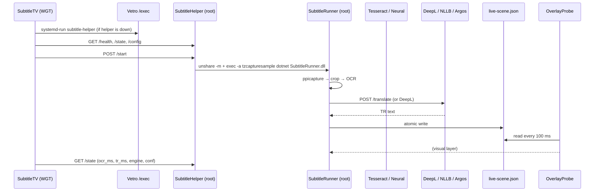

# Architecture

Runtime components, data flow, and on-TV file layout.

## 1. Overview

The system has four layers:

1. **TV app (WGT)** — UI: start/stop, region, style, diagnostics.
2. **Root helper (C#)** — a small HTTP service running as root; starts/stops the runner, writes config.
3. **Runner (C#)** — the pipeline: screen capture → crop → OCR → translation → scene file.
4. **Overlay (C#/EFL)** — a notification window that draws over the game and watches `live-scene.json`.

An optional **translation server** (Mac/PC) runs NLLB/Argos on the LAN to remove cloud latency.



## 2. Components

### 2.1 WGT — `app/`

- Package `SubtitleTV`, app `SubtitleTV.subtitle`.
- Tizen `tv-samsung` profile; 1920×1080 layout; remote-key navigation.
- Screens: hub, subtitle style (size/position/opacity/colour), source region (x/y/w/h + presets), translation, diagnostics.
- Talks to the helper at `http://127.0.0.1:18765` (CORS enabled).
- If the helper is down, sends a `no-cors` POST to Vetro's `/exec` to run `systemd-run subtitle-helper`.

### 2.2 Root helper — `helper-dotnet/`

- `SubtitleHelper.dll`, started as root via `systemd-run --unit=subtitle-helper`.
- Listens on `127.0.0.1:18765`; CORS `*`.
- API: `GET /health`, `GET /state`, `GET /config`, `POST /config`, `POST /start`, `POST /stop`.
- `/start`:
  - Kills any running runner/overlay (`pkill` patterns).
  - Runs:
    `unshare -m /bin/sh -c 'mount --make-rprivate / && mount --bind /opt/usr/subtitle-ocr /run/subtitle-ocr && mount -o remount,bind,ro /run/subtitle-ocr && exec /usr/bin/bash -c "exec -a /usr/bin/tzcapturesample /usr/bin/dotnet /opt/usr/subtitle-ocr/SubtitleRunner.dll 0"'`
  - This makes the OCR models visible under `/run/subtitle-ocr` and bypasses the capture whitelist.
- State: `/tmp/subtitle-probe/status.json`.

> `bash -c "exec -a ..."` is used because Tizen UEP rejects unsigned **script files** (“not signed”). There is no separate `.sh` runner script.

### 2.3 Runner — `runner/`

- `SubtitleRunner.dll` runs as root; the mount namespace comes from the helper.
- Main loop (~250–600 ms):
  1. `PpiDump.Capture()` → `ppicapture` (720×540/576 YUV; only Y is used).
  2. Writes `frame.y` and `frame.meta`.
  3. Reads config (`/opt/usr/subtitle-ocr/config.json`).
  4. Crops the region; row projection finds text bands.
  5. Single/multi-line decision; crop + padding.
  6. OCR: Tesseract CLI (`--psm 7/6`) or the neural MNN worker.
  7. Text cleanup (`==>`, speaker prefix, trailing noise).
  8. Translation: local `/translate` endpoint or DeepL.
  9. Atomic write of `live-scene.json`.
- Translation runs in a separate async loop (TranslateLoop); UI/OCR is not blocked.
- Dead OCR workers are restarted by `StartNeural`/`StartOcr`.
- State: `/tmp/subtitle-probe/status.json` (`running`, `capture`, `last.ocr`, `last.tr`, `ocr_ms`, `tr_ms`, `engine`, `conf`, `error`).
- Log: `/tmp/subtitle-probe/runner.log`.

### 2.4 Overlay — `overlay/`

- `OverlayProbe.dll` creates an EFL/Elementary **notification window** (type 12, level 40).
- 1920×1080 transparent window; reads `live-scene.json` every 100 ms.
- Empty scene → window hidden; text → shown.
- Object types: `subtitle`, `text`, `textblock`, `rectangle`, `ellipse`, `line`, `polygon`, `image`.
- `subtitle`: `text`, `size`, `x`, `width`, `bottom`, `padding_x`, `padding_y`, `align`, `color`, `background_color`, `style` (outline/shadow).
- `bottom` is the **bottom edge y coordinate** in 1080p. A small value (e.g. 220) puts the band near the top; ~1000 near the bottom.

### 2.5 Translation servers — `servers/`

- `translate-server.py` — Argos/OPUS-MT; port **18880**; ~30–50 ms.
- `nllb-server.py` — NLLB-200-distilled-600M, CTranslate2 int8; port **18881**; ~100–165 ms.
- API: `POST /translate` `{ "text": "...", "source": "EN", "target": "TR" }` → `{ "tr": "...", "ms": 42 }`.
- `nllb-server.py` preserves speaker prefixes (`Aunt May:`) when the model drops them.

## 3. On-TV file layout

```text
/opt/usr/subtitle-ocr/          # persistent; mount source
  SubtitleRunner.dll
  SubtitleRunner.runtimeconfig.json
  OverlayProbe.dll
  OverlayProbe.runtimeconfig.json
  tesseract                     # Tesseract 5.5.1 (ARM)
  tessdata/eng.traineddata
  neural-worker                 # MNN CRNN
  rec.mnn
  rec-keys.txt
  deepl-key                     # optional, 0600
  config.json

/opt/usr/subtitle-helper/
  SubtitleHelper.dll
  SubtitleHelper.runtimeconfig.json

/tmp/subtitle-probe/            # runtime (cleared on reboot)
  frame.y, frame.c, frame.meta
  input.pgm, neural.pgm
  live-scene.json
  status.json
  runner.log

/run/subtitle-ocr/              # bind-mounted from /opt/usr/subtitle-ocr in the runner namespace
```

## 4. Lifecycle

1. TV boots; the Vetro service and root agent start (`/status` → `agent.connected`).
2. The user opens **SubtitleTV**.
3. The app checks `/health`; on failure it runs the helper via Vetro `/exec` + `systemd-run`.
4. The app loads config; **Start** → `POST /start`.
5. The helper starts the runner; the overlay opens (empty scene → hidden).
6. As lines appear, the runner translates; the overlay shows the Turkish band.
7. **Stop** → `POST /stop`; runner/overlay are killed; the scene is cleared.
8. After a TV reboot the helper is transient and does **not** autostart; opening the app restarts it.

## 5. Latency budget

| Step | Typical |
|---|---|
| `ppicapture` + copy | 40–80 ms |
| Crop + row projection | 5–15 ms |
| Tesseract (2x, PSM 7) | 100–270 ms |
| Neural MNN OCR | 500–700 ms |
| NLLB-600M (LAN) | 100–165 ms |
| Argos (LAN) | 30–50 ms |
| DeepL (cloud) | 300–900 ms |
| Overlay draw | ~10 ms |

Total: **~0.2–0.3 s** with Argos, **~0.3–0.5 s** with NLLB, **~0.6–1.2 s** with DeepL. “0 ms” is impossible: capture + OCR + translation always exist. True instant only for pre-translated/cached lines.

## 6. Why root?

- `ppicapture` and the TEE-based capture API require a process whitelist.
- The EFL `notification` window and TV composition layer are not available to a WGT.
- The `/run/subtitle-ocr` bind mount and `/opt` writes need root.
- A Tizen WGT cannot call these APIs; the WGT is UI only.
